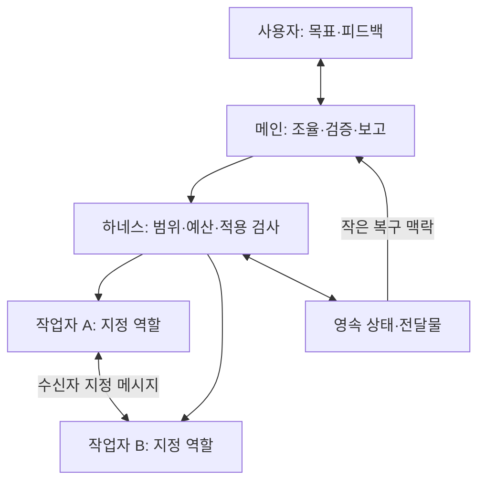

# loop-work

**목표를 말하면 맥락을 복원하고, 작업을 수행하고, 결과를 확인해 기록하는 Claude Code·Codex 공통 하네스**입니다.

`$loop-work <작업 내용>` 또는 `/loop-work <작업 내용>`으로 **명시한 한 작업**에 하네스를 적용합니다.
메인 대화는 목표·사용자 피드백·작업 조율·결과 보고에 집중하고, 실제 조사·계획·구현·작성은
분리된 작업자에게 위임합니다. 작업은 **목표 설정 → 작업**으로 진행합니다. 개발은 구현·테스트·독립 검토·수정을 반복하고,
문서·설명·조사·계획은 결과를 작성해 완료 조건을 확인합니다. 에이전트가 실행 상태와 로컬 지식을
관리하므로 사용자가 코드 구조, 이전 답변, 다음 행동을 프롬프트마다 다시 설명할 필요가 없습니다.

## 시작

하네스 실행 환경은 macOS/Linux, Python 3.10+, Git입니다. Windows는 WSL을 사용합니다.
기본 `make install`은 사용자 요청에 따라 Obsidian을 확인하고, 없으면 기존 Homebrew로
설치한 뒤 `~/.loop-work/vault` 문서 공간을 준비합니다. Python 런타임에는 추가 패키지가 필요 없습니다.
실제 작업은 로그인된 Claude Code 또는 Codex CLI에 위임합니다. 개발은 대상 Git 저장소와 작업 CLI가 필요합니다. 반대 CLI가 설치돼 있으면 교차 검토하고,
없으면 같은 제공자의 새 독립 호출로 검토합니다. 선택은 사전 기록하며 호출 실패로 바꾸지 않습니다. 문서·설명은 일반 디렉터리에서 작업 CLI 하나로 수행합니다.
작업 전에는 에이전트가 사용 가능한 모델·effort와 상대적인 비용·능력 순위를
`execution.routing`에 설정합니다. 준비된 설정은 `LOOP_ROUTING_PROFILE`로 가져올 수 있습니다.
계정에서 사용할 모델을 확인하지 않은 채 CLI 기본값으로 실행하지 않습니다.

```sh
git clone https://github.com/minjoonchoi/loop-work.git
cd loop-work
# 범위를 하나 선택: 모든 프로젝트
make install
# 또는 특정 프로젝트만
# make TARGET=/absolute/path/to/project install
```

설치 시 단일 vault 폴더와 `.obsidian`을 준비하며 기존 노트·설정은 덮어쓰지 않습니다.
앱의 전역 vault 등록·동기화·플러그인 설정은 바꾸지 않습니다. Obsidian에서 이 폴더를 열면 됩니다.
앱이 없을 때 자동 설치는 기존 Homebrew가 필요하며, Homebrew 자체는 설치하지 않습니다.
설치가 지원되지 않거나 실패하면 원인을 표시하고 성공으로 처리하지 않습니다. 앱 설치와 vault 준비는
`make install`의 설치 단계이고, 작업 실행이나 저수준 복사/벤치마크 설치가 brew를 호출하지 않습니다.
`make uninstall`은 하네스 연결만 해제하며 Obsidian·vault·작업 기록을 보존합니다.
기존 DB가 있으면 설치 때 문서도 내보냅니다. 노트 충돌·출력 실패는 경고로 구분해 기록하며
그 이유만으로 스킬 설치를 막지 않습니다. 빈 DB나 새 세션·목표를 자동 생성하는 과정은 아닙니다.

대상 디렉터리에서 작업 내용을 붙여 명시적으로 실행합니다.

| 환경 | 시작 입력 |
| --- | --- |
| Claude Code | `/loop-work 메모를 저장하고 조회하는 CLI를 만들어 줘` |
| Codex | `$loop-work 메모를 저장하고 조회하는 CLI를 만들어 줘` |

이 작업의 진행 질문·관련 정정·맥락 압축은 같은 작업을 이어갑니다. 완료 또는 중단 폐기(abort) 시
자동 적용을 해제합니다. 이후 무관한 일반 요청에는 하네스를 자동 적용하지 않습니다.
새 작업은 다시 스킬과 작업 내용을 명시합니다. 진행 중 새 명시 작업도 기존 작업을 조용히 교체하지 않습니다.
내용 없는 스킬 호출은 작업 내용을 한 번 묻고 세션·목표를 만들지 않습니다.
일시 중지·blocker는 완료가 아니며 기존 작업·예산을 보존합니다. 진행 확인만으로 재개하지 않습니다.
`off`는 기존 바인딩의 자동 처리를 해제하는 호환 명령이며 기록·파일·예산은 지우지 않습니다.

| 상황 | 하네스 처리 |
| --- | --- |
| 일반 요청 또는 완료 후 무관한 새 요청 | 자동 적용 없음 |
| 스킬과 작업 내용 명시 | 해당 한 작업에 결속 |
| 진행 중 관련 정정·상태 확인·경로 이동·맥락 압축 | 같은 작업 유지 |
| 완료·abort | 자동 결속 해제, 기록·예산 보존 |
| board/human 명령 | 기존 작업·활성 상태를 바꾸지 않는 관리 명령 |

Claude `disable-model-invocation: true`, Codex `allow_implicit_invocation: false`를 유지합니다.
호스트가 관련성에 따라 분류하며 전역 훅이나 키워드 파서가 메시지를 가로채지 않습니다.

`make install`은 사용자 스킬 경로 `~/.agents/skills/loop-work`와
`~/.claude/skills/loop-work`를 `~/.local/share/loop-work/install`의 관리 어댑터에 연결합니다.
`TARGET=/absolute/path/to/project`는 그 프로젝트의 `.agents/skills/`·`.claude/skills/`와
`.loop/install`을 사용합니다. 기존 지침·다른 스킬·설정과 로컬 변경은 보존합니다.
런타임과 규칙은 원본 저장소를 참조합니다. 원본을 옮겼다면 새 위치에서 같은 설치 명령을
다시 실행해 연결합니다. 재설치 전에는 이전 경로를 사용할 수 없습니다.
스킬 본문/메타데이터 변경도 같은 설치 명령으로 갱신합니다.

```sh
# 설치한 범위에 맞춰 선택
make uninstall
# make TARGET=/absolute/path/to/project uninstall
```

설치/갱신/해제 후 새 대화를 열거나 호스트의 스킬 새로고침 절차를 따릅니다.
현재 대화에 이미 로드된 지침은 해제로 지워지지 않습니다. 활성 대화는 진입 파일이
없어지면 자동 처리를 멈추고 이를 알리며 다른 경로로 우회하거나 재활성화하지 않습니다.
폴더 이동 때도 반환된 절대 진입 경로·규칙 경로·지식 홈·세션 ID를 유지합니다.
기존 복사 설치 `python3 scripts/install.py --target /absolute/path/to/project`는
독립 복사본이 필요한 환경과 봉인된 벤치마크에 계속 사용할 수 있습니다.
`make uninstall`과 연결 설치 전환은 새 연결 설치만 관리하며 기존 복사 설치를 제거하지 않습니다.
설치/해제는 반복 실행해도 안전하며 충돌은 파일 변경 전에 거절합니다. 프로젝트 설치는
호스트별 연결·런타임·상태의 관리 `.gitignore` 블록을 추가합니다. 해제는 목표·상태·지식 기록을
보존하고, 상태 기록이 남으면 `/.loop/state/` 제외 규칙도 남깁니다.

## 작업 보드 열기

Codex에서는 **`$loop-work board serve`**, Claude Code에서는 **`/loop-work board serve`**로
작업 보드를 엽니다. `board`만 적어도 serve로 처리합니다. localhost 서버를 시작하고 기본
브라우저를 자동으로 열며, `--no-open`이면 서버만 실행합니다. 요청한 로컬 화면을 여는 데
다시 승인을 요구하지 않습니다.

```sh
python3 scripts/loop.py board serve --port 0
# 별도 지식 홈: --knowledge-home을 subcommand 앞에 두고 vault도 명시
# python3 scripts/loop.py --knowledge-home /absolute/knowledge board serve --vault /absolute/vault
# 브라우저를 열지 않으려면 뒤에 --no-open
```

작업 카드·상세·추적 문서·사람 요청의 **표시 데이터는 Obsidian vault의 Markdown**입니다.
런타임 SQLite/JSON은 실행·권한·검증 상태를 확인합니다. 문서가 없거나 stale이면 DB 내용을
화면에 조용히 대신 채우지 않고 진단을 보여 주며, 수정한 Markdown만으로 QA·완료·승인을
우회할 수 없습니다. 사람 노트와 문서 편집은 보존합니다.

board는 활성화보다 먼저 분기하며 기존 entrypoint·knowledge home·session·task를 유지합니다.
하네스가 off여도 켜지 않고 새 목표·세션을 만들지 않습니다. 승인/해결된 `resume_task`도
명시적인 실행이 별도이며, 응답만으로 모델 호출·예산 초기화·QA·병합·배포를 하지 않습니다.
실행이 저장됐는데 vault 출력이 실패한 경우에는 실행을 반복하지 않고 문서 오류로 구분합니다.

보드에서 진행 중 작업에 원문 보완·제약·일시 중지·재개를 직접 전달할 수 있습니다.
재개는 pause 피드백만 해제하며 phase blocker·예산·QA를 우회하지 않습니다. 중지는 관찰 지점에서
실제 진행 중 호출을 멈추며 이미 적용된 변경을 자동 되돌린다고 약속하지 않습니다.

기존 `$loop-work human` / `/loop-work human`과 `human list|show|request|respond|execute|serve`
CLI는 호환성을 유지합니다. 새 요청 생성·명시 대체 등 CLI 관리는 [운영 문서](docs/operations.md#사람의-결정과-수동-조치)를 따릅니다.

## 기존 loop-dev 설치에서 전환

기존 연결 설치가 있으면 새 설치는 변경 없이 중단합니다. 원본 저장소에서 기존 연결을 제거한 뒤 설치합니다.

```sh
python3 scripts/install.py --uninstall-legacy
make install
# 프로젝트 범위는 두 명령 모두 같은 경로 지정
# python3 scripts/install.py --uninstall-legacy --target /absolute/project
# make TARGET=/absolute/project install
```

수정된 기존 설치 파일은 덮어쓰거나 삭제하지 않습니다. 복사 설치는 자동 전환하지 않으며
기존 manifest의 소유 파일과 로컬 수정을 대조해 정리한 뒤 연결 설치합니다.
기존 `~/.local/share/loop-dev/knowledge.sqlite3`가 있으면 그 위치를 계속 사용해 기록과 전달물 경로를
보존합니다. 새 이름과 옛 이름의 DB가 모두 있으면 `LOOP_KB_HOME`으로 사용할 것을 명시해야 합니다.
`.loop/`의 목표·상태와 `LOOP_*` 환경 변수는 그대로 유지합니다. 새 대화에서 `/loop-work` 또는
`$loop-work <작업 내용>`으로 한 작업을 시작합니다. 이전 연결 진입점은 전환 안내와 함께 중단하고 자동 실행하지 않습니다.

## 두 단계의 역할

| 단계 | 대화가 관리하는 일 | 사용자가 하는 일 |
| --- | --- | --- |
| 목표 설정 | 지식·이전 답변 확인, 조사 위임, 결과·범위·완료 조건 구체화 | 목표 전달; 해결되지 않은 사용자 결정에만 답변 |
| 작업 | 범위를 정해 도구에 위임, 결과 확인, 관련 지식 갱신, 결과 보고 | 결과 확인 |

명확한 요청은 내부적으로 목표를 정한 뒤 바로 진행합니다. 목표 설정이 매번 질문이나 승인을
받는 단계는 아닙니다. 현재 구현 수준은 원하는 목표 수준을 낮추는 근거가 아닙니다.
작업 시작 뒤에는 합의한 범위에서 질문 없이 진행합니다. 외부 장애나 권한 부족으로 끝낼 수
없으면 원인과 미완료 범위를 기록하며 성공으로 표시하지 않습니다.

| 작업 유형 | 수행과 완료 확인 |
| --- | --- |
| 개발 | 사전 독립 검토 → 목표·규칙 고정 → 구현·테스트·독립 검토·수정 → 전체 최종 검증 |
| 문서·설명 | 작성·설명 후 내용과 전달물 조건 확인 |
| 조사·읽기 전용 검토 | 근거 조사 후 결론·불확실성·범위 확인 |
| 계획 | 실행 없이 계획과 요청한 판단 기준 확인 |

비개발 작업에 정해진 반복 횟수나 교차 검토를 강제하지 않습니다. 실제 오류나 누락은 수정합니다.
여러 저장소의 개발은 같은 세션에 연결한 저장소별 목표로 수행하고, 필요한 통합 검증까지 완료해야 합니다.

요구사항으로 PRD 작성, PRD로 상세 기획·HTML 목업 작성, 기획·목업으로 프론트엔드/백엔드 구현,
백엔드 API의 프론트엔드 연동, 백엔드 설계·기능 명세, 전체 시스템 설계의 작성·갱신에 같은 방식을
적용합니다. 요청에 필요한 기존 자료를 먼저 찾아 연결하고 사용자 피드백과 현재 구현을 대조합니다.
매번 모든 단계를 수행하거나 사용자가 맥락을 다시 입력할 필요는 없습니다. 원본이 바뀌면 기록된
의존 지식과 영향받는 결과물을 확인해 현재 작업 범위에서 갱신합니다.

## 대화와 작업 도구의 경계



| 담당 | 책임 |
| --- | --- |
| 메인 대화 | 목표·사용자 피드백 정리, 작업 분할, 후보 결과의 목표 기여 확인·채택/폐기·보고 |
| 작업 도구 | 전달받은 범위의 조사·계획·구현·문서 작성; 부족한 입력은 장애로 반환 |
| 하네스 | 모델·effort 선택, 후보 보관, 채택한 수정 적용, 메시지 전달, 테스트·독립 검토와 기록 |

위임은 **목적·읽을 범위·수정할 파일·금지 사항·산출물·완료 조건**을 갖습니다. 필요한 현재 지식과
선행 작업 결과만 선택해 전달합니다. 작업 도구는 목표를 확장하거나 다른 도구에 재위임하지 않습니다.
읽기 전용 CLI가 반환한 결과는 먼저 **후보**로 보관합니다. 메인이 목표와 완료 조건에 대한
근거를 확인해 내부 `assess`로 채택한 뒤에만 수정·전달물을 반영합니다. 사용자에게 승인을
다시 요구하는 단계가 아닙니다. 도구의 `done`은 맡긴 작업의 완료이며, 개발 전체 완료는
기존 게이트가 판정합니다. 문서·설명도 같은 내용·완료 조건 확인을 거칩니다.

| 결정 | 기준 |
| --- | --- |
| 작업 분할 | 별도로 검증할 수 있는 목표 기여가 있을 때만 분리; 의존성과 파일별 수정 담당 지정 |
| 첫 모델·effort | 복잡도·오류 영향·불확실성을 충족하는 프로필 중 설정된 비용 순위가 가장 낮은 것 |
| 높은 수준으로 시작 | 실제 위험·불확실성 등 구체적인 근거가 있을 때 |
| 품질이 부족한 결과 | 전체 후보를 폐기하고 같은 작업을 더 높은 능력의 모델 또는 effort로 재실행 |
| 권한·인증·시간 초과·변경된 입력 | 장애를 해결하거나 미완료로 기록; 모델 상향으로 대체하지 않음 |

작은 작업은 하나의 위임으로 처리하고, 모든 작업을 큰 모델·높은 effort에서 시작하지 않습니다.
폐기한 내용은 감사 기록으로만 남기며 지식이나 다음 작업의 사실로 전달하지 않습니다.
재시도는 작업별 최대 3회와 공통 호출·시간 예산 안에서 수행합니다. 설정의 순위는 실제
가격이나 성능 측정값이 아니므로 비용 절감 효과는 벤치 결과로 확인해야 합니다.
자세한 분할·선택 기준은 [라우팅 규칙](rules/routing.md)에 있습니다.

지시의 범위와 공급자 권한은 읽기 동작을 제한하며, 파일별 OS 격리를 제공하는 것은 아닙니다.
실제 적용되는 수정은 정확한 허용 경로와 원본 해시로 검사합니다. 자세한 계약은
[위임 규칙](rules/delegation.md)을 따릅니다.

여러 역할이 협력해야 하면 `team`으로 고정된 역할과 범위를 부여합니다. 작업자는 별도 CLI 맥락에서
실행되며, 서로에게 질문·답변·발견 사항을 보낼 수 있습니다. 메인이 후보를 채택하면 하네스가
수신자와 근거를 검사한 메시지를 다음 작업자 호출에 전달합니다. 에이전트가 같은 팀 명령을
이어 실행하므로 사용자가 다음 프롬프트를 보낼 필요가 없습니다. 호출·대화 횟수는 제한되며,
파일 적용은 순서대로 진행합니다. 공급자의 실시간 채팅이나 동시 파일 수정을 전제하지 않습니다.
작은 단일 작업에는 기존 `delegate`를 사용합니다. 개발의 최종 독립 검토는 그대로 유지됩니다.

매 사용자 입력·작업 결과·맥락 압축 뒤에는 `orchestration context`의 **최대 16KiB 복구 맥락**부터
읽습니다. 현재 목표·제어 상태·역할별 결과와 전달물 위치만 확인하고, 필요할 때 해당 근거를 엽니다.
전체 로그·출력·메시지는 디스크에 보존하며, 메인 대화에 모두 복사하거나 별도 요약을 계속 쌓지 않습니다.
작업 중 피드백은 버전이 있는 기록으로 남겨 영향받는 작업자에게 전달하고 수정 적용 전에 확인합니다.
고정한 목표·완료 조건을 바꾸는 요청은 기존 작업을 막고 새 목표로 진행합니다. 이는 맥락 사용을
줄이기 위한 구조이며, 호스트의 압축 빈도나 실제 모델 품질 개선을 보장하지는 않습니다.

## 다시 설명하지 않아도 이어지는 지식

로컬 지식베이스는 프로젝트, 작업 위치, 세션, 작업 이력을 연결합니다. 같은 Git origin의 여러
체크아웃은 프로젝트를 공유하지만 파일 상태는 각각 확인합니다. 관계없는 프로젝트의 분석과
한 번만 허용한 결정은 다른 작업에 자동 적용하지 않습니다.

- 새 요청 전에 유효한 분석·답변을 읽고, 빠진 정보와 관련 변경만 조사합니다.
- 파일 수정·추가·삭제·이름 변경, 규칙·브랜치 변경으로 영향을 받은 지식을 재확인 대상으로 표시합니다.
- 에이전트가 변경을 조사한 뒤 해당 항목을 갱신합니다. 조회만으로 오래된 결론을 최신으로 만들지 않습니다.
- 확정 사실·초안·가설·과거 결과를 구분합니다. 과거 성공 기록은 현재 검증이나 새로운 권한을 대신하지 않습니다.

신규 기본 위치는 `~/.loop-work/data/`이며 `LOOP_KB_HOME` 또는 `--knowledge-home`을
명시하면 그 위치를 사용합니다. 기존 `~/.local/share/loop-work/`·legacy `loop-dev` DB는
자동 이동 없이 재사용합니다. 프로젝트 밖에 두며 전역 공급자 설정을 수정하지 않습니다.
세션 ID와 저장 명령은 에이전트가 관리합니다.

## Obsidian에서 결과 읽기

보드는 `~/.loop-work/vault`의 Markdown을 표시 데이터로 사용합니다. 같은 문서를 Obsidian에서도 엽니다.
새 문서는 `projects/인증서버--<project-id>/tasks/권한검사-수정--<task-id>/현재-권한검사-수정--<task-id>.md`처럼
프로젝트·작업 내용을 이름으로 구분하고 안정적인 ID를 함께 유지합니다. 기존 관리 경로는 이동하지 않고
한국어 프로젝트·주제·작업 색인에서 연결합니다. 한국어 설명과 상태를 사용하되 사용자 원문·코드·명령·증거는 바꾸지 않습니다. 마지막 상태를
보고, `interim/`·`final/`에서 시점별 중간/완료 기록을 읽습니다. 직접 쓸 메모는 `notes/`에 둡니다.
완료 파일의 존재만으로 현재 QA 통과나 최신 근거가 보장되지는 않습니다. 원본은 DB와 개발 JSON이며
사람 노트는 보존합니다. 출력 오류는 하네스 실행을 막지 않습니다. 경로·근거 전달 범위는
[지식 운영](docs/knowledge.md#obsidian-문서-공간)을 따릅니다.

## 읽기 쉬운 실행 기록

실행 상태는 **목표·현재 단계·근거·다음 행동/장애**로, 지식은 **결론·적용 범위·상태·근거**로 작성합니다.
필요하면 이유, 세부사항, 불확실성만 추가합니다. Markdown은 저장된 구조화 데이터에서 생성하므로
에이전트와 사람이 서로 다른 요약을 읽지 않습니다.

요약은 한 줄 280자 이내이며 선택적인 세부사항은 최대 다섯 개입니다. 긴 설명과 모든 근거는
연결된 전달물·JSON에 보존합니다. 중복 내용, 임시 문구, 과도하게 긴 요약은 저장 단계에서 거절합니다.
변화 없는 기록은 새 버전으로 쌓지 않고, 목록은 개수·검색·페이지로 탐색합니다.
문장 의미와 근거의 정확성은 에이전트가 확인합니다. 길이 검사만으로 글의 품질을 보장하지 않습니다.

출력 원칙은 [ELI5](https://github.com/DreambigOu/ELI5)와
[i-have-adhd](https://github.com/ayghri/i-have-adhd)를 참고했습니다.
적용 기준은 [작성 규칙](rules/writing.md)에 있습니다.

## 내부 명령과 저장 위치

하네스 운영 명령은 에이전트가 실행합니다. 설치된 스킬은 `python3 SKILL_DIR/loop.py`로 시작한 뒤 반환된 절대 진입 경로를 사용합니다.
이 저장소는 `python3 scripts/loop.py`, 기존 복사 설치는 `python3 .loop/loop.py`를 사용합니다. 사용자가 JSON이나 ID를 직접 관리할 필요는 없습니다.

| 용도 | 명령 |
| --- | --- |
| 작업 결속 | `harness on --task TASK_ID`, `harness status`, `harness off` |
| 공통 작업 | `work open`, `work goal`, `work start`, `work delegate`, `work team`, `work assess`, `work finish` |
| 메인 복구·피드백 | `orchestration context`, `orchestration feedback` |
| vault 작업 보드 | `board serve`(기본 브라우저 열기), `board serve --no-open`(서버만) |
| 지식 재사용·갱신 | `knowledge context`, `knowledge remember`, `knowledge get`, `knowledge history` |
| 프로젝트 연결 | `knowledge projects`, `knowledge attach` |
| 개발 | `init`, `delegate`, `team`, `assess`, `validate`, `doctor`, `plan-review`, `freeze`, `start`, `checkpoint`, `finish` |
| 하네스 자체 평가 | `bench check`(전체 실행), `bench plan`, `bench run`, `bench judge`, `bench report`, `bench gate`, `bench proposal` |
| 맥락·복구 | `context`, `status`, `note`, `block`, `retire`, `resume`, `abort`, `session`; 공통 작업은 `work` 하위 명령 |

| 위치 | 내용 |
| --- | --- |
| `.agents/skills/loop-work/`, `.claude/skills/loop-work/` | 환경별 명시적 스킬 진입점 |
| `.loop/goals/<id>/` | 개발 목표와 최초 진단; Git 포함 권장 |
| `.loop/state/<id>/` | 개발 상태·검증 로그·맥락·`status.md`; Git 제외 |
| `.loop/state/sessions/` | 개발 세션의 분석과 이전 답변; Git 제외 |
| `LOOP_KB_HOME/knowledge.sqlite3` | 작업 결속·공통 지식·프로젝트·작업·위임·실행 예산 및 이전 버전 |
| `.loop/state/<id>/delegations/`, `LOOP_KB_HOME/runs/` | 작업자 지시·결과·원본·로그; 팀 메시지와 상세 전달물은 반환된 참조로 조회 |
| `LOOP_KB_HOME/views/` | 같은 기록에서 생성한 Markdown과 JSON 뷰 |
| `~/.loop-work/data/` | 새 설치의 기본 지식 DB·실행 산출물; 기존 지식 홈이 있으면 그대로 재사용 |
| `~/.loop-work/vault/` | 프로젝트·작업별 중간/최종 보고서의 Obsidian 문서 공간 |

공통 `work finish`로 개발 게이트를 우회할 수 없습니다. 개발 완료에는 실제 검사와 새로운
독립 검토가 필요하며, 소스·목표·규칙 변경으로 이전 증거가 만료됩니다. 커밋·병합·배포는 완료
판정의 자동 부작용이 아닙니다. 사전에 허용된 전달 범위에 따라 에이전트가 수행합니다.

배경 데몬은 없습니다. 요청·맥락 조회·작업 전환 때 기록을 확인하고 갱신합니다. 호스트가 종료되면
보존된 상태에서 재개합니다. 다른 컴퓨터에서는 필요한 로컬 상태를 의도적으로 옮겨야 합니다.

## 하네스가 실제로 더 나은지 평가

벤치는 같은 요청을 **하네스 미사용 / 현재 하네스 사용** 두 조건으로 반복 실행합니다.
기본 모드는 같은 모델·effort·초기 파일·예산을 사용하고, 대화·지식베이스·작업 공간을 각각 분리합니다.
모델 선택 정책까지 평가할 때는 `--routing-profile /absolute/profile.json`으로 두 조건에
같은 허용 프로필 풀을 제공합니다. 설정을 바꾼 실험은 별도 전후 비교 기준으로 관리합니다.
기능은 외부 검사로, 문서·설명은 익명 결과물의 기준별 평가로 확인합니다.
완료 선언이나 작업량 자체에는 점수를 주지 않습니다.

특정 과제의 품질 저하, 추가 사용자 질문, 과도한 시간 증가를 발견하면 통과를 막습니다.
**개선 / 회귀 없음 / 회귀 / 근거 부족**을 구분하고, 실패 근거와 관련 규칙을 연결해
변경 가설을 저장합니다. 규칙 변경 후 같은 기준으로 재측정하며, 코드나 평가 기준이
바뀌면 이전 통과 결과가 만료됩니다.

터미널에서 Claude와 Codex의 모델·effort를 각각 지정하면 한 명령으로 비교 실행·결과물 채점·게이트·
개선 리포트까지 생성합니다. **서로 다른 목표 유형을 2개 이상** 평가해야 하며, 기본은
개발·문서·설명입니다. 같은 유형의 사례만 여러 개 넣으면 실행 전에 거절합니다.

```sh
python3 scripts/benchmark.py \
  --claude-model "$BENCH_CLAUDE_MODEL" --claude-effort "$BENCH_CLAUDE_EFFORT" \
  --codex-model "$BENCH_CODEX_MODEL" --codex-effort "$BENCH_CODEX_EFFORT"
```

협업과 후속 피드백 대응 결과를 평가하려면 위 명령에
`--suite benchmarks/team-suite.json`을 추가합니다. 개발·문서 과제의 최종 결과와 현재 근거를
비교하며, 작업자 수나 압축 빈도 자체에 점수를 주지 않습니다. 기본 벤치 구성은 바뀌지 않습니다.

대화 세션을 열거나 스킬을 미리 켤 필요가 없으며, 커밋 SHA도 입력하지 않습니다.
현재 파일을 복사해 실행하고 변경 여부 확인용 해시는 자동 저장합니다.
같은 설정의 **직전 통과 결과를 자동 저장해 수정 전후도 비교**합니다. 최초 수정 전 한 번
기준을 측정한 뒤 같은 명령으로 재검증합니다. 사용/미사용과 전후 비교를 모두 통과해야
기준이 갱신됩니다. 동급 결과는 개선으로 표시하지 않으며, 퇴행·근거 부족이면 기존 기준을 유지합니다.
`--dry-run`은 실행 조건과 예산만 확인합니다. `improvements.md`에는 유형별 판정과
우선 개선할 항목을, `improvements.json`에는 측정 근거·원인 가설·변경 범위·재검증 조건을
저장합니다. 모델 비교는 같은 공통 평가자로 채점합니다.

벤치 요청과 실행 방법, 대표 과제, 판정의 한계는 [벤치마크 안내](docs/benchmark.md)에 있습니다.
실제 모델 호출이 필요한 기능이며, 아래 단위 테스트의 성공은 품질 우위를 입증하지 않습니다.

## 개발 및 검증

```sh
python3 -m unittest discover -s tests -v
git diff --check
```

외부 패키지 없이 임시 Git 저장소와 **가짜 Claude/Codex CLI**로 게이트, 복구, 지식 재사용, 문서 생성,
설치, 작업 결속·완료 후 해제·분리, 위임 범위·수정 적용, 벤치 비교 실행·회귀 판정을 검증합니다.
작업 분할·프로필 선택·후보 채택/폐기·상향 재시도도 같은 방식으로 검증합니다.
실제 계정의 모델 호출 품질은 검증하지 않습니다.
시작 전 읽기 전용 분석 위임으로 작업 CLI를, 개발 `plan-review`로 검토 CLI를 확인합니다.
호스트가 중첩 CLI 실행을 금지하면 제한을 우회하지 않고 시작 전에 해결하거나 장애로 기록합니다. CI는 macOS/Linux × Python 3.10/3.12입니다.

- [공통 작업과 지식 운영](docs/knowledge.md)
- [설계와 상태 전이](docs/architecture.md)
- [개발 계약과 질문 정책](docs/contract.md)
- [개발 운영·검증·장애 대응](docs/operations.md)
- [하네스 품질 벤치마크](docs/benchmark.md)
- [공통 진입 규칙](rules/work.md)

단일 Codex 환경의 벤치 예시(명시적 모델·effort는 사용 가능한 값으로 선택):

```sh
python3 scripts/benchmark.py --provider codex --codex-model gpt-6.1-sol --codex-effort low --repeats 3
```

Claude CLI가 없으면 Claude 모델·effort 인수는 필요 없습니다. `--repeats 1`은 전송·구성
확인용이며 품질 검증 통과 근거가 아닙니다. 새 단일 제공자 프로필의 첫 실행은 별도 baseline입니다.


공개 중단 명령은 이제 `block GOAL --input FILE` / `work block TASK --input FILE`의
typed 근거 입력이 필수이며 reason-only 입력은 거절합니다. 실패한 단위의 예산과 전체
작업 예산을 구분합니다. `retire`는 승인된 대체 작업과 현재 근거로 완료 의무를 교체하되
원래 실패·시도 이력과 최종 검증 조건을 보존합니다. V2 위임은 검증 책임, 누적 정정,
exact-base patch와 standalone request revision을 지원합니다(팀은 revision 1 한정).
[입력·마이그레이션 안내](docs/operations.md#typed-block-and-retirement)를 따릅니다.
